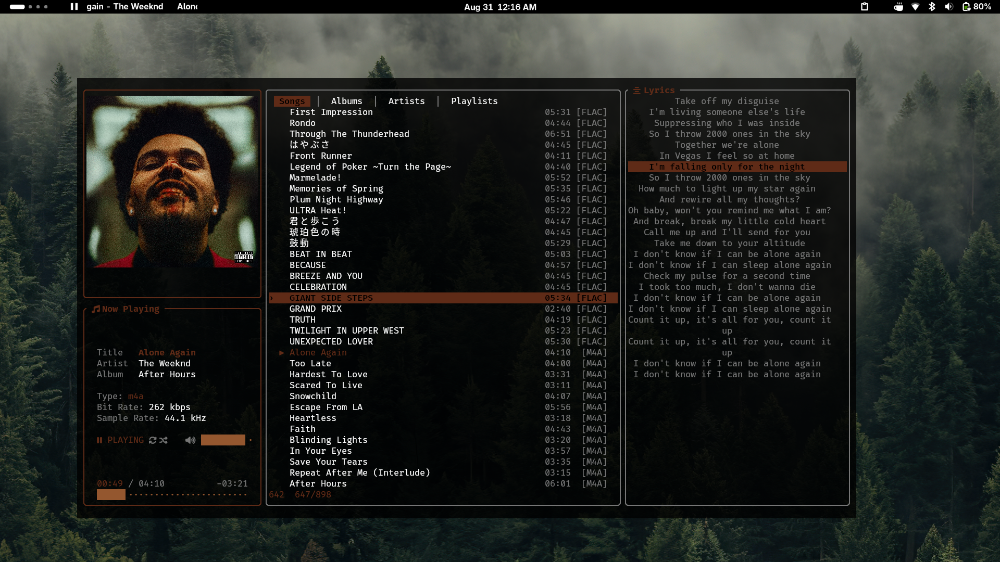

# 🎵 aghani (أغاني)

A fast, feature-rich music player with a terminal interface and an optional desktop GUI.



## Features

- 🖼️  Album art in the terminal (Kitty/Sixel/half-block)
- 🎨  Dynamic themes extracted from album art
- 📝  Synced lyrics (auto-fetched + manual editing)
- 📚  Library browser: Songs, Albums, Artists, Playlists
- 🔀  Shuffle & repeat modes
- 🔌  MPRIS2 support (media keys, playerctl)
- 🔗  IPC socket for i3blocks/waybar integration
- ⚡  Fast startup with metadata cache
- 🎯  Gapless playback
- 🔊  ReplayGain normalization
- 🖥️  Native desktop GUI built with egui/eframe

The GUI and TUI use the same library, playback engine, playlists, configuration,
session state, lyrics cache, MPRIS integration, and IPC server.

## Dependencies

- `ffmpeg` — audio playback and seeking
- `chafa` — cover support
- A terminal with true color support (kitty, wezterm, alacritty, etc.)

## Installation

### From crates.io

```bash
cargo install aghani
```

### From source

```bash
git clone https://github.com/yourusername/aghani
cd aghani
cargo build --release --no-default-features --features tui
sudo cp target/release/aghani /usr/local/bin/
```

The default Cargo feature is `tui`. To build the optional desktop GUI instead,
use `--no-default-features --features gui`. The eframe dependency is optional
and is not built for TUI-only builds.

## Run from source

```bash
# Terminal interface
cargo run --no-default-features --features tui
cargo run --no-default-features --features tui -- ~/Music

# Desktop GUI
cargo run --no-default-features --features gui
cargo run --no-default-features --features gui -- ~/Music
```

Only one interface feature may be enabled for a build. The GUI reuses the
existing keyboard shortcuts and also provides clickable transport, library,
playlist, search, lyrics, metadata, artwork, and settings controls. Its “Up next” panel previews the active playback context and supports
adding, reordering, skipping to, and removing queued tracks. The queue is an
additive GUI feature; the existing TUI playback/navigation remains unchanged.

The GUI uses top-level library tabs, a resizable Now Playing/Up Next panel,
and a separate lyrics panel. Search results open in a floating,
keyboard-navigable window. Its four layouts are `1` (Now Playing and library),
`2` (Now Playing only), `3` (library and playback bar), and `4` (library only).
The `l` shortcut toggles lyrics without changing the selected layout; uppercase
`L` opens the lyrics panel in the GUI. Lyrics can also be edited from the
panel's Edit action. The panel's Flag action marks the displayed lyrics as
wrong and hides them for that song; use Unflag to show them again.

The GUI's Appearance settings provide Classic Dark, Light, Artwork Ambient,
and OLED / Deep Black themes. Artwork Ambient derives an accent from the
playing album and uses a blurred, contrast-tinted background in Now Playing
and Lyrics when artwork is available. The selected theme and lyrics text size
are saved in the existing configuration. Arabic display text is reshaped and
right-to-left reordered; Arabic and Japanese glyph coverage uses installed
system fonts when available.

### AUR (Arch Linux)

```bash
yay -S aghani
```

## Usage

```bash
aghani                    # use music dir from config
aghani ~/Music            # specify music directory
aghani --dir ~/Music      # same with flag
aghani --help             # show help
aghani --caches           # show cache locations
aghani --clear-caches     # clear all caches
```

## Keybinds

| Key | Action |
| ----- | -------- |
| `Space` | Play / Pause |
| `n` / `p` | Next / Previous |
| `Up` / `Down` | Navigate |
| `Enter` | Select / Open |
| `Tab` | Switch tab |
| `/` | Search |
| `s` | Save to playlist |
| `Shift+S` | Cycle sorting for the active list |
| `f` | Add to favorites |
| `r` | Toggle shuffle |
| `Shift+R` | Toggle repeat |
| `>` / `<` | Seek ±5s |
| `=` / `-` | Volume |
| `g` | Go to playing track |
| `t` | Go to the top of the list |
| `b` | Go to the bottom of the list |
| `l` | Show lyrics |
| `L` | Edit lyrics in the TUI; open lyrics in the GUI |
| `'` | Synchronize lyrics line by line |
| `e` | Edit the selected song's metadata, or an album/artist/playlist image |
| `Shift+I` | Set a custom image for the selected album, artist, or playlist |
| `Shift+F` | Show the selected song in the file manager |
| `1`–`4` | Switch layout |
| `x` | Back |
| `q` | Quit |

Songs and ordinary playlist contents default to Last added (reverse library
scan order), and have independent sort settings. `Shift+S` cycles sorting for
the active list: songs by Last added, First added, title, artist, album, or
duration; albums by name, artist, or track count; artists by name, album count,
or song count; and playlists by name or track count. History and Most Played
retain their generated song order.

To synchronize plain lyrics, play the song and press `'` (single quote). The sync
editor starts on the first line; press `Down` as each line is sung to stamp the
current playback position. `Space` pauses or resumes playback, `Esc` saves the
timestamps recorded so far, and stamping the final line saves automatically.
Synchronized lyrics use the same manual LRC cache as `L`.

## Configuration

Config file: `~/.config/aghani/conf`

```toml
music_dir = "/home/user/Music"

[colors]
dynamic_theme = true
dynamic_theme_style = "vibrant"  # vibrant | muted | dark | light
accent = "Cyan"
title = "Cyan"

[layout]
mode = "default"  # default | compact | wide | minimal
show_cover = false
show_player = true
cover_width = 40

[keys]
quit = "q"
play_pause = "Space"
next = "n"
prev = "p"
```

## i3blocks Integration

```bash
# ~/.local/bin/aghani-ctl
echo "$1" | socat - UNIX-CONNECT:/tmp/aghani.sock > /dev/null 2>&1

```

```ini
[aghani]
command=echo "status" | socat - UNIX-CONNECT:/tmp/aghani.sock > /dev/null 2>&1; cat /tmp/aghani-status 2>/dev/null
interval=1
```

## License

MIT — see [LICENSE](LICENSE)
